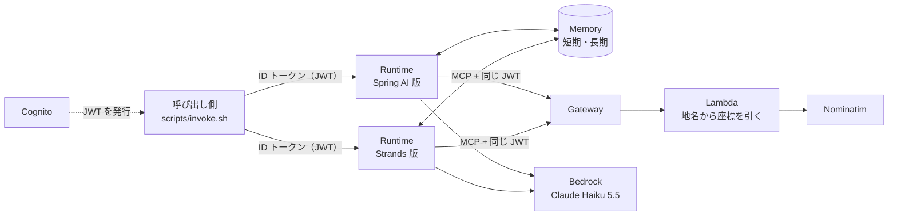

# spring-ai-bedrock-agentcore

[spring-ai-bedrock-agent](../spring-ai-bedrock-agent/) で作ったエージェントを、Amazon Bedrock AgentCore にデプロイする検証です。
同じエージェントを **Spring AI 版** と **Strands Agents 版** の 2 つで作り、AgentCore の上で並べて動かします。

確かめたいことは 2 つです。

- spring-ai-bedrock-agent で「本番で運用するには足りない」と分かったものを、AgentCore で補えるか
- Spring AI の AgentCore SDK は、AgentCore のどの機能に対応しているか。Strands Agents と比べてどうか

## 構成



| フォルダ | 中身 |
|---|---|
| [spring/](spring/) | Spring AI 版のエージェント（Spring Boot 4.1.1 / Spring AI 2.0.1 / Spring AI AgentCore SDK 2.3.0 / Java 25） |
| [strands/](strands/) | Strands 版のエージェント（Python 3.12。依存の版は `uv.lock`） |
| [gateway/geocoding/](gateway/geocoding/) | Gateway のツールにする Lambda（地名から座標を引く。2 つの版で共有） |
| [cdk/](cdk/) | Cognito・Gateway・Memory・Runtime（2 つ）を作る CDK（Java） |
| [scripts/](scripts/) | 利用者を作る、ID トークンを取る、Runtime を呼ぶ、のスクリプト |

2 つの版は、同じ入出力（`{"prompt": "..."}` → `{"message": "...", "places": [...]}`）、同じシステムプロンプト、同じモデル、同じツール、同じ Memory を使います。

### 2 つの版で揃えたこと

| | Spring AI 版 | Strands 版 |
|---|---|---|
| 入口 | `@AgentCoreInvocation`（[AgentInvocation.java](spring/src/main/java/com/ryotashi29/cnj/ai/agentcore/agent/AgentInvocation.java)） | `@app.entrypoint`（[app.py](strands/src/outing_agent/app.py)） |
| メモリ | SDK の advisor（短期 + 長期。長期の戦略は AWS から自動で読む） | `AgentCoreMemorySessionManager`（長期の名前空間は自分で書く） |
| ツール | Gateway の MCP のツールを、MCP Java SDK で呼ぶ | Gateway の MCP のツールを、Strands の `MCPClient` で呼ぶ |
| 回答の形 | `entity(AgentAnswer.class)` + ネイティブの構造化出力 | `structured_output_model=AgentAnswer` |
| 誰の会話か | JWT の `sub` を actorId にする（[ConversationIds.java](spring/src/main/java/com/ryotashi29/cnj/ai/agentcore/agent/ConversationIds.java)） | 同じ（[conversation.py](strands/src/outing_agent/conversation.py)） |

**誰の会話かを、呼び出し側の値で決めない**ようにしています。AgentCore Memory の会話は「actorId（誰の）＋ sessionId（どの会話）」で引きます。
actorId は、Runtime が検証した JWT の `sub` から取ります。セッション ID だけで会話を引けると、spring-ai-bedrock-agent の「会話 ID を知っていれば他人の会話を読める」と同じ問題が残るためです。

## 確かめたこと

主要な機能（Runtime・Memory・Identity の受け側・Gateway）は、AWS 上で 2 つの版を動かして確かめました。観測と評価も動かしましたが、詳しい比べ方は別の検証で扱います。

### 結果

| spring-ai-bedrock-agent で足りなかったもの | AgentCore の機能 | 確かめたこと | Spring AI 版 | Strands 版 |
|---|---|---|---|---|
| 再起動・複数台でメモリが消える | Memory | Runtime のセッションを止めたあとも、同じセッション ID で会話の続きを呼べるか | 続いた | 続いた |
| メモリに残るのは発言と最終の回答だけ | Memory | ツールの呼び出しと結果まで残るか | **残らない**（3 往復で 6 件。発言と最終の回答だけ） | **残る**（3 往復で 24 件。ツールの呼び出しと結果、推論の過程、構造化出力のための内部のやり取り、エージェントの状態まで） |
| 他人の会話を読める | Runtime と Gateway の JWT の検証、Memory の actorId（JWT の `sub`） | トークンなし・改ざんしたトークンで呼べないか。別の利用者が同じセッション ID で前の会話を読めないか | 401 で拒否。別の利用者には「提案内容が残っていない」と答えた | 同じ |
| ツールを呼ばないことがある | Evaluations | 振る舞いを測れるか | **評価の対象にならない**（`No evaluable agent spans found for the session`） | 10 問すべてでツールを呼び、座標もツールの結果から取っていた |
| 監視がどこにも送られない | Observability | トレースが CloudWatch に届くか | 届く。ただし ADOT の Java エージェント・SDK の拡張・Micrometer Tracing のブリッジの組み合わせが要る | 届く。ADOT の自動計装（`opentelemetry-instrument`）だけ |

- **長期メモリ（好み・要約）も、2 つの版とも使えました。** 新しいセッションで「私が普段どんなお出かけ先を探しているか」と聞くと、どちらの版も、過去の会話から抜き出された好みをもとに答えました。別の利用者（bob）には「記録がない」と答えました。2 つの版は同じ Memory と同じ actorId を使うので、長期メモリの「好み」は 2 つの版の会話をまとめたものになりました
- Runtime 自体のメトリクス（呼び出し回数、応答時間、エラー、認証の成功と失敗など）は、どちらの版も設定なしで `AWS/Bedrock-AgentCore` に届きました。
- 評価は `scripts/evaluate.py`（AgentCore Evaluations のバッチ評価）で、`Builtin.TrajectoryAnyOrderMatch`（ツールを呼んだか）と `Builtin.GoalSuccessRate`（座標をツールの結果から取っているか）を使いました。Spring AI 版の span は、評価が対応している出どころ（instrumentation scope）ではありません。

### 応答時間（参考）

評価用の 10 問（`scripts/eval-prompts.txt`）を、1 問ずつ新しいセッションで投げたときの値です。

| | 平均 | 最短〜最長 |
|---|---|---|
| Spring AI 版 | 15.8 秒 | 14.2〜17.9 秒 |
| Strands 版 | 14.3 秒 | 11.2〜21.5 秒 |

応答時間を縮める方法は、別の検証で扱います。

## 手元で動かす

AgentCore の外（手元）でも、2 つの版とも起動できます。手元では Memory と Gateway を使わないので、ツールは呼べません（会話の流れと `/ping` を確かめる程度です）。

```bash
# Spring AI 版
cd spring && ./gradlew build && ./gradlew bootRun     # http://localhost:8080/ping

# Strands 版
cd strands && uv run pytest && uv run outing-agent    # http://localhost:8080/ping

# Gateway の Lambda のテスト
cd gateway/geocoding && python3 -m unittest
```

## AWS で動かす

> **注意**：AWS に環境を作ると料金がかかります（Runtime、Memory、Gateway、Lambda、Cognito、ECR、CloudWatch、Bedrock の呼び出し）。
> 確かめ終わったら、必ず `cdk destroy` で消してください。

CDK の CLI は 2.1146.0 以降が必要です（`aws-cdk-lib` 2.274.0 のため）。Docker（arm64 のイメージをビルドできるもの）も必要です。

```bash
cd cdk
AWS_PROFILE=<プロファイル> AWS_REGION=ap-northeast-1 cdk deploy

# 利用者を作り、ID トークンを取る（パスワードは自分で決める）
cd ..
AWS_PROFILE=<プロファイル> AWS_REGION=ap-northeast-1 ./scripts/create-user.sh alice '<パスワード>'
TOKEN=$(AWS_PROFILE=<プロファイル> AWS_REGION=ap-northeast-1 ./scripts/id-token.sh alice '<パスワード>')

# 呼ぶ（セッション ID は 33 文字以上）
SESSION=session-$(uuidgen)
TOKEN=$TOKEN AWS_PROFILE=<プロファイル> AWS_REGION=ap-northeast-1 \
    ./scripts/invoke.sh spring "$SESSION" "東京で、犬と一緒に行ける広い公園を教えて"

# 片付け
cd cdk && AWS_PROFILE=<プロファイル> AWS_REGION=ap-northeast-1 cdk destroy
```

- リージョンは東京（`ap-northeast-1`）にしてください。モデルは日本国内の推論プロファイル（`jp.`）を使うので、ほかのリージョンでは呼べません
- `AWS_REGION` は毎回付けてください。付けないと、シェルに入っているリージョンに作ろうとします

## 作るときに分かったこと

- **Spring AI 版の Memory の設定は、プロファイルに分けた。** `agentcore.memory.memory-id` は、値が空でも設定されていると SDK の自動構成が動き、起動に失敗します（`MemoryId cannot be null or empty`）。
  手元では使わないので、AgentCore の上で使う設定を `application-agentcore.yml` に分け、CDK が `SPRING_PROFILES_ACTIVE=agentcore` を渡します
- **Spring AI の SDK は、ツールのメッセージをメモリに保存しない。** SDK の README によると、`ToolResponseMessage` は保存の対象外です（`ignore-unknown-roles` のデフォルトが true）。
  一方、Strands の `AgentCoreMemorySessionManager` は、デフォルトでツールの呼び出しも保存します（`filter_restored_tool_context` のデフォルトが False）。AWS 上でも、そのとおりの違いが出ました（上の結果を参照）
- **長期メモリの名前空間の決め方が違う。** Spring AI 版は Memory の戦略を AWS から読んで自動で決めます（auto-discovery）。Strands 版は、名前空間を自分で書きます（ここでは環境変数 `AGENTCORE_MEMORY_NAMESPACES`。CDK で戦略に付けた名前空間と揃える）
- **Runtime は、デフォルトでは `Authorization` をコンテナに渡さない。** `requestHeaderConfiguration` で許可しないと、Gateway に送るトークンと、actorId に使う JWT の `sub` が取れません
- **Cognito の ID トークンで認証するなら、`usingCognito` ではなく `usingJWT` を使う。** `usingCognito` は JWT の `client_id` を確かめる設定を必ず入れますが、ID トークンは `client_id` を持たない（`aud` を持つ）ので 401 になります。Gateway も同じです
- **JWT の検証は、設定したときだけ行われる。** Runtime のデフォルトの認証は IAM の署名（SigV4）です。Gateway は、作るときに認証の方式を選びます。このスタックでは、両方に JWT の設定を入れています
- **Cognito のアプリクライアントは、OAuth のフローを明示して無効にする。** CDK のデフォルトでは、implicit と code のフローが `https://example.com` のコールバックで有効になります。Hosted UI を使わないなら `disableOAuth(true)` にします
- **Memory の L2 の `grantRead` には、`GetMemory` が入っていない。** Spring AI 版の長期メモリの自動読み込み（auto-discovery）に要るので、作った Memory だけに絞って足しています
- **Spring AI 版のトレースは、3 つの部品を組み合わせる。** ADOT の Java エージェント（AWS の署名を付けて送る）、Spring AI AgentCore SDK の otel-extension（CloudWatch の GenAI Observability 用の属性を付ける）、Micrometer Tracing の OpenTelemetry のブリッジ（Spring AI の Observation を span にする。`ObservabilityConfig`）。Java の送り先は Runtime が入れないので、CDK の環境変数で渡します
- **バッチ評価には、span のロググループ（`aws/spans`）と Runtime のロググループの両方を渡す。** Runtime のロググループだけだと「span がない」で失敗します
